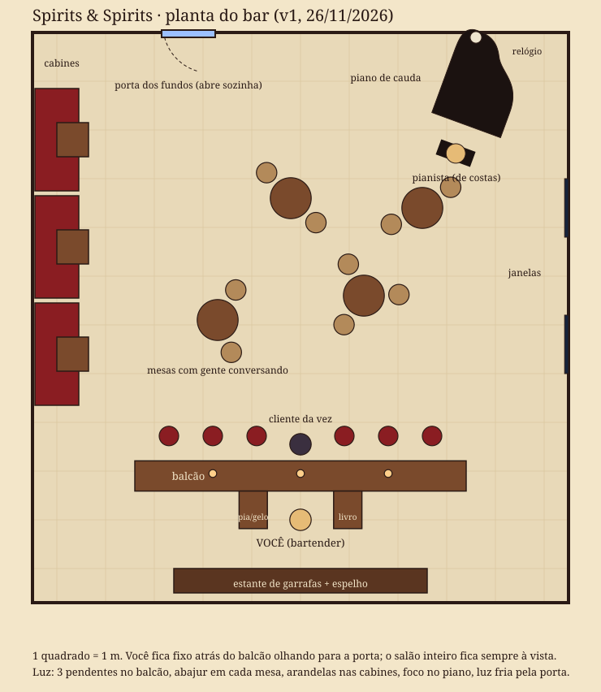
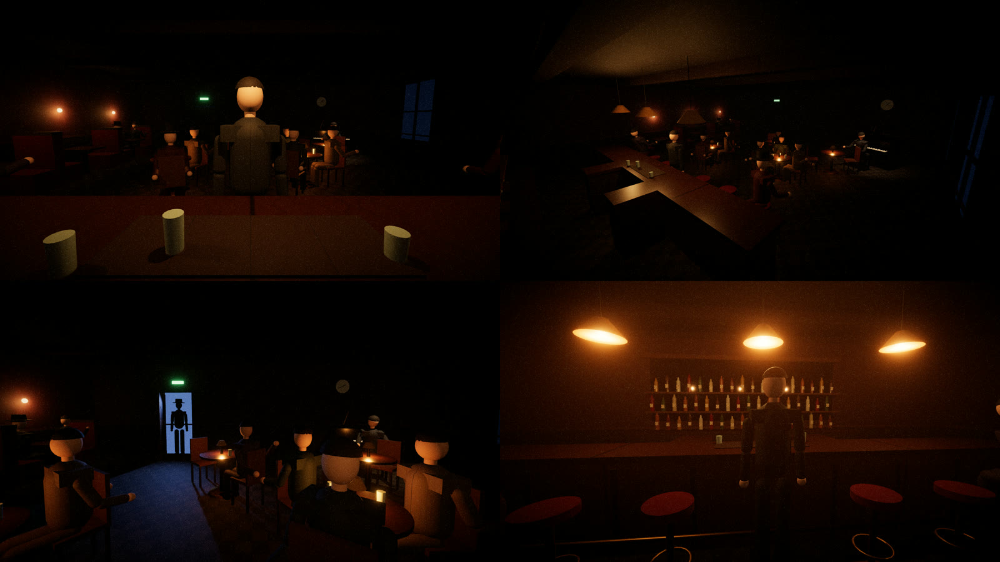
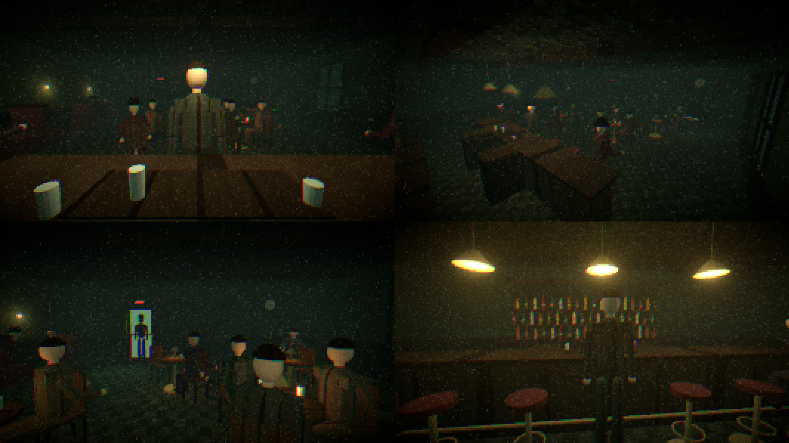
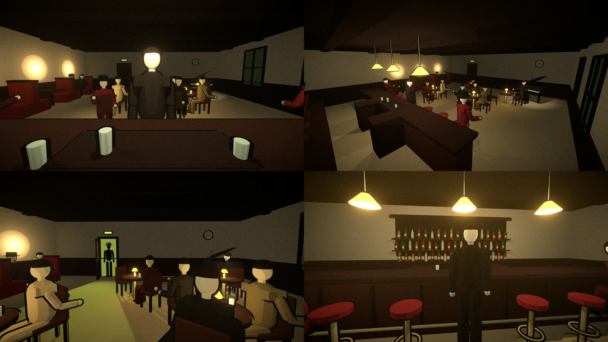
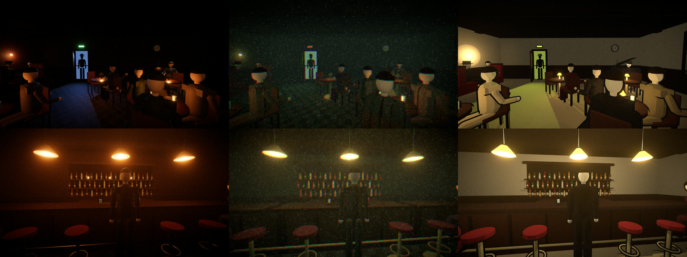

# Três estilos para o redesign · v1 (26/11/2026)

Pedido do Felipe: *"proponha 3 estilos. mas entenda que quero uma vibe meio eerie, 3d, quero que voce proponha alguns estilos ja tendo em mente e desenhando o bar como um todo, cena de bar realista, mesas no fundo pessoas conversando porta que abre la atras pianista tocando, tudo mais"*

Os três estilos foram montados **no próprio motor do jogo**, sobre o mesmo bar, e podem ser vistos ao vivo:

```sh
npm run dev   # abra http://localhost:5173/estilos.html
```

Teclas **1 2 3** trocam o estilo, **V** troca a vista e **H** esconde o painel. Arraste para olhar. **Ligar som** toca o piano no fundo do bar, o murmúrio das mesas e o rangido da porta, com som 3D.

## O bar como um todo



- **Você** fica fixo atrás de um balcão longo, de frente para o salão e de costas para a estante de garrafas com espelho. O cliente da vez fica no meio do balcão. Outros dois clientes ficam sentados nas banquetas.
- **Salão**: quatro mesas redondas com abajur, gente sentada conversando e gesticulando.
- **Cabines de veludo** na parede esquerda, com arandelas. Um casal conversa na cabine do fundo.
- **Janelas altas** na parede direita, com a noite lá fora.
- **Piano de cauda** no canto do fundo à direita. O **pianista toca de costas para você**, sob um foco de luz.
- **Porta dos fundos** com placa de SAÍDA. A cada ~20 s ela **abre sozinha**: entra uma luz fria e aparece **uma silhueta parada no batente**, que some quando a porta fecha.
- **Relógio** na parede do fundo, com o ponteiro dos minutos rápido demais.

As pessoas são manequins sem rosto, porque o modelo final dos personagens vem depois. O que se avalia aqui é **luz, material, cor e clima**.

## 1. Âmbar Noturno · realismo pintado



Um bar elegante demais para aquela hora. Os materiais são quase reais: madeira, latão, veludo e vidro. A luz quente cai em poças e os cantos somem no escuro. O medo vem do contraste: tudo é bonito, mas a luz nunca alcança o salão inteiro.

- **Referências:** Edward Hopper (*Nighthawks*), o salão dourado de *O Iluminado*, Manet.
- **Produção:** é o estilo mais trabalhoso. Exige modelos e texturas bem feitos no Blender, com luz pré-calculada (baked). O Windows com RTX faz esse cálculo.
- **No Quest:** ok com luz baked, poucas luzes dinâmicas e texturas comprimidas.

## 2. Fita Perdida · terror retrô



O bar lembrado por uma fita gasta: imagem pixelada, texturas de baixa resolução, neblina verde e granulação. O estranho já está na própria imagem.

- **Referências:** terror da era PS1, VHS e found footage.
- **Produção:** é o estilo mais barato. Perdoa modelos simples e já chega pronto para dar medo.
- **No Quest:** é o mais leve. **Cuidado:** imagem pixelada na tela inteira cansa os olhos em VR. No headset o certo é baixa resolução só nas texturas, não na imagem.

## 3. Gravura · ilustração em tinta



Um livro de contos macabros que ganhou volume. Tem sombra em faixas, contorno preto de nanquim e paleta curta: creme, vinho, preto e um verde doente.

- **Referências:** gravuras de Goya e Redon, quadrinhos de Mike Mignola.
- **Produção:** custo médio. As formas precisam ser fortes, mas a textura é quase nula. Os personagens podem deformar sem parecer "erro técnico".
- **No Quest:** o contorno dobra o número de objetos desenhados. Ainda cabe, mas precisa de controle.

## Comparação lado a lado



## Decisão (26/11/2026)

**Escolhido: Âmbar Noturno**, mantido igual do começo ao fim do jogo. Felipe: *"não descaradamente terror e sim super climatizado e ambientalizado"*. Os assets atuais (pessoas, garrafas, objetos) ainda não foram aprovados.

## Recomendação original (antes da decisão)

**Âmbar Noturno como base, "virando fita" ao longo da noite.**

O Felipe pediu um bar realista, e o Âmbar é o que mais entrega presença em VR. O Fita Perdida dá medo na hora, mas como ponto de partida o jogo deixaria de "começar genuinamente normal", que é uma regra do devlog.

A proposta é usar a degradação da imagem como parte da história. O Ato I é Âmbar puro. A cada ato a imagem ganha grão, perde cor, a luz pisca, o som do piano "embola" como fita velha e a neblina fecha. No Ato IV, o bar parece o estilo Fita Perdida, mas com a resolução preservada para o conforto em VR. A curva do ambiente, que só sobe, fica visível na própria imagem.

A Gravura fica como plano B, caso a equipe queira um visual autoral com menos trabalho de textura.

## O que ainda não é final

- Personagens, rostos e roupas: todos são manequins provisórios.
- O piano é sintetizado no navegador. A trilha real do pianista vem no sistema de música viva.
- O tremor de vértices do estilo Fita foi desligado. Em algumas vistas ele apagava a imagem.
- Nada foi medido no Quest. A cena do laboratório usa luzes dinâmicas, que na versão final viram luz baked.
